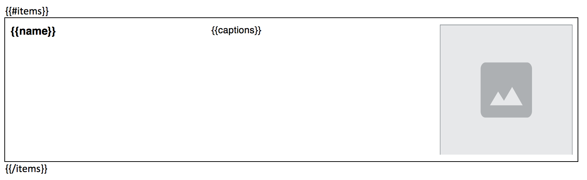

# DocxMustache *for Laravel 12.x and 13.x*

[](https://github.com/wrklst/docxmustache/actions/workflows/tests.yml) [](LICENSE) [](https://scrutinizer-ci.com/g/wrklst/docxmustache/?branch=master) [](https://scrutinizer-ci.com/g/wrklst/docxmustache/build-status/master) [](https://styleci.io/repos/90483440)

Docx template manipulation class for Laravel 12.x and 13.x, based on [mustache templating language](https://mustache.github.io). This class is still under heavy development and works more like proof of concept at the moment. Things will change quickly and might break things.



With DocxMustache, you can:
- Replace text using Mustache syntax.
- Embed images dynamically.
- Support basic HTML styling (bold, italic, underline).

---

## Installation

Install the package via Composer:

```bash
composer require wrklst/docxmustache
```

## Usage

```php
use WrkLst\DocxMustache\DocxMustache;

// the template is read from <storagePathPrefix><template> on the given (local) disk
$docx = new DocxMustache(['items' => $items], 'example_template.docx', storageDisk: 'local', storagePathPrefix: 'app/');
$docx->execute();          // execute(144) stores images with more pixels for high resolution screens

$path = $docx->storagePath($docx->local_path.$docx->template_file_name); // the generated docx
$pdf = $docx->saveAsPdf(); // optional, needs LibreOffice
```

Each run writes into its own working directory `<storagePathPrefix>DocxMustache/<unique id>/`.

### Cleanup

Every run first deletes the working directories of earlier runs that are older than 48 hours, **including the documents generated in them**. Move a result away if you need it longer, or change the lifetime (in hours):

```php
$docx = new DocxMustache($data, 'template.docx', tmpDirLifetime: 2);
$docx->tmpDirLifetime = 0.5;  // or as a property, before execute()
$docx->tmpDirLifetime = null; // never delete anything
```

See the `example` folder for a template and a controller.

---

## Features

### HTML Conversion

Basic HTML conversion is supported, including:
- Bold (`<b>`, `<strong>`)
- Italic (`<i>`, `<em>`)
- Underline (`<u>`)
- Line breaks (`<br>`)

Values are escaped by default, so HTML in them shows up as text. To have a value treated as HTML, prefix it with:

```php
*[[DONOTESCAPE]]*
```

**Limitations:**
- Tags are lowercase, without attributes, and have to be closed.
- Styles combine only when the tags are nested (`<b>bold <i>and italic</i></b>`).
- Everything else in such a value has to be valid XML: escape text with `htmlspecialchars($value, ENT_COMPAT, 'UTF-8')`.

---

### Replacing Images

Dynamic image replacement is supported. Follow these steps:

1. Add the image source (supported format) to the image's **alt text description** field in the DOCX template.
2. Use pseudo-tags around it. The path must be absolute and inside `storage_path()`:

```text
[LOCAL_IMG_REPLACE]/var/www/app/storage/app/logo.png[/LOCAL_IMG_REPLACE]
```

   Images can also be fetched over HTTP by putting a URL of your own inside `[IMG-REPLACE]` / `[/IMG-REPLACE]` instead.

**Notes:**
- Images will be resampled to match the constraints of the placeholder image in the template and stored as JPEG. GIF, JPEG, PNG and BMP sources are supported.
- If an image cannot be loaded, the placeholder image stays.
- Pictures are replaced in the main document, headers, footers, footnotes and endnotes.
- The picture has to be stored the way current Word versions do (DrawingML). Pictures in documents converted from the old `.doc` format (VML) are ignored: insert the picture again in a `.docx`.

---

### DOCX to PDF Conversion

To enable DOCX-to-PDF conversion, install `libreoffice-common` on your server:

```bash
sudo apt install libreoffice-common
```

For Arial font support, install:

```bash
sudo apt-get install ttf-mscorefonts-installer
```

---

## Dependencies

### Requirements
- PHP 8.3 or newer (required by intervention/image 4)
- Laravel 12.x or 13.x (`illuminate/support`)
- The `zip`, `gd`, `simplexml` and `fileinfo` PHP extensions

### Required Packages
- [mustache/mustache](https://packagist.org/packages/mustache/mustache) 2.x or 3.x
- [intervention/image](https://image.intervention.io) 4.x, used with its GD driver. No provider or alias is needed.

### Laravel-Specific Dependencies
If you want to port the package to a non-Laravel environment, consider replacing:
- **Storage and File Classes**: Based on [Flysystem](https://flysystem.thephpleague.com), can be replaced with PHP native file handling.
- **Process Handling**: Uses `\Symfony\Component\Process\Process` for PDF conversion.

---

## Example

Check out the `example` folder for a sample template and controller.

---

## Testing

```bash
composer install
composer test
```

---

## Contributions

Contributions are welcome! To contribute:
1. Fork the repository.
2. Create a pull request with your changes.
3. Include a corresponding issue for discussion.

We’ll be happy to review and discuss your ideas!

---

## Why Another DOCX Templating Solution?

While there are existing libraries for DOCX manipulation, they often:
- Use proprietary or non-standard templating syntaxes.
- Focus on complex feature sets, making them heavyweight for simple use cases.

DocxMustache was designed to:
- Use the widely adopted Mustache syntax.
- Provide simple and intuitive value and image replacement.
- Support repeating content in multiple dimensions.

### Alternatives
Here are other popular PHP libraries for DOCX manipulation:
- [openTBS – Tiny But Strong](http://www.tinybutstrong.com/opentbs.php)
- [PHPWord](https://github.com/PHPOffice/PHPWord)
- [docxtemplater pro](https://modules.docxtemplater.com) (MIT licensed; image replacement requires a commercial plugin)
- [docxpresso](http://www.docxpresso.com) (commercial)
- [phpdocx](https://www.phpdocx.com) (commercial)
